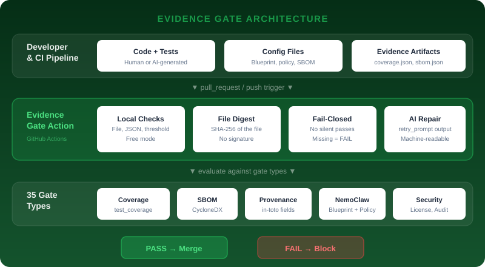

[English](README.md) | **日本語**

# Evidence Gate Action

GitHub Actions 向けのフェイルクローズド品質ゲート。Free モードは CI 上のエビデンスファイルを検査します。

**AI がコードもテストも書く時代。成果物を CI でどう確認しますか？** Evidence Gate はパイプラインの成果物を品質基準に照らして評価し、基準を満たさないマージをブロックします。**Free モード（提供中）**は、エビデンスファイルが存在すること、JSON として妥当であること、数値しきい値を満たすことを検査し、各ファイルの SHA-256 ダイジェストを記録します。このダイジェストは検査したバイト列を示すもので、署名はなく、外部のログにも書き出しません。

**Blind Gate、L4 ハッシュチェーン、Pro、ホスティング版 API は準備中です。** `api.evidence-gate.dev` は未公開で、API キーは発行していません。予定している L4 の記録は、鍵も署名もない `sha256(previous + evidence_hash)` です。これは **改ざん検知可能（tamper-evident）** です。チェーンの残りをそのままにした単一レコードの変更は検知できます。書き込み権限を持つ者がチェーン全体を書き直すことは防げません。

これは CI/CD 品質ゲートの強制ツールです。AI コードレビューツールでも、AI エージェントのガードレールでもありません。GitHub 上には「Evidence Gate」という名前を共有する無関係のプロジェクトが複数存在しますが、本プロジェクトは CI/CD パイプラインにおける品質を強制するものです。

[](https://github.com/marketplace/actions/evidence-gate-action)
[](LICENSE)

## クイックスタート

任意の GitHub Actions ワークフローに以下のステップを追加してください：

```yaml
- uses: evidence-gate/evidence-gate-action@v2
  with:
    gate_type: "test_coverage"
    phase_id: "testing"
    evidence_files: "coverage.json"
```

エビデンスが有効であればステップは成功します。エビデンスが欠落または無効であればステップは失敗します。サイレントパスは発生しません。

## 必要なもの

> **ホスティング版API（Pro）は現在準備中です。公開時期は追ってお知らせします。** Free モード（ローカル評価・API キー不要）は現在ご利用いただけます。Pro/Enterprise の API キーはまだ発行しておらず、`api.evidence-gate.dev` は現時点では利用できません。

| | Free（提供中） | Pro / Enterprise（準備中） |
|---|---|---|
| **API キー** | 不要 | `api_key: ${{ secrets.EVIDENCE_GATE_API_KEY }}`（未発行） |
| **実行内容** | ローカル検証（ファイル存在確認、JSON の妥当性、数値しきい値）と、各エビデンスファイルの SHA-256 ダイジェスト | 予定しているホスト型評価: Blind Gates、改ざん検知可能なハッシュチェーン (L4)、品質状態 |
| **ゲートタイプ** | 35 種中 30 種（Pro 限定の 5 種を除く）。ローカルモードでは評価回数の上限なし | Pro 限定 5 種を含む全 35 種 |
| **最適な用途** | オープンソースプロジェクト、基本的なエビデンスファイル検査 | API 公開後にホスト型検査を使いたいチーム（予定） |

カスタム `api_base` は、将来のセルフホスト向け入力です。Enterprise は現在販売しておらず、デフォルト URL のホスティング版 API は準備中です。

## 利用シーン

- **AI 支援開発** -- LLM がコードとテストの両方を生成する場合、カバレッジファイルは数値を満たすだけで品質をほとんど示しません。Free モードは、エビデンスファイルの存在、JSON の妥当性、数値しきい値を検査します。基準をパイプラインの外に置く Blind Gates はホスティング版 API の予定機能で、現在は利用できません
- **CI の記録** -- 各実行は、合否とエビデンスファイルの SHA-256 ダイジェストを Actions のログとジョブサマリーに残します
- **デプロイメントゲーティング** -- エビデンスファイルが存在し、ローカル検査に通らない限り、デプロイをブロックします
- **マルチゲートパイプライン** -- 単一のアクションでカバレッジ、セキュリティ、ビルドのゲートを順次実行します

## パーミッション

| 機能 | `contents` | `checks` | `id-token` | `pull-requests` |
|------|:----------:|:--------:|:----------:|:---------------:|
| 基本的なゲート評価 | `read` | -- | -- | -- |
| Check Run アノテーション | `read` | `write` | -- | -- |
| OIDC キーレス認証 (Pro、準備中) | `read` | -- | `write` | -- |
| PR スティッキーコメント | `read` | -- | -- | `write` |

Check Run をサポートする一般的なワークフロー：

```yaml
jobs:
  gate:
    runs-on: ubuntu-latest
    permissions:
      contents: read
      checks: write
    steps:
      - uses: evidence-gate/evidence-gate-action@v2
        with:
          gate_type: "test_coverage"
          phase_id: "testing"
          evidence_files: "coverage.json"
```

## 入力

| 入力 | 必須 | デフォルト | 説明 |
|------|:----:|-----------|------|
| `gate_type` | いいえ | `""` | 評価するゲートタイプ（例: `test_coverage`、`security`、`build`、`skill`）。`.evidencegate.yml` がある場合は省略可能 |
| `phase_id` | いいえ | `""` | フェーズ識別子（例: `build`、`test`、`deploy`）。`.evidencegate.yml` がある場合は省略可能 |
| `evidence_files` | いいえ | `""` | エビデンスファイルパスのカンマ区切りリスト |
| `api_key` | いいえ | `""` | Evidence Gate API キー。Free モードでは省略。ホスティング版API（Pro）は準備中のため、キーは未発行です |
| `api_base` | いいえ | `https://api.evidence-gate.dev` | API ベース URL（`api_key` 設定時のみ使用）。デフォルト URL のホスティング版 API は準備中で未公開です。カスタム URL は受け付けますが、Enterprise は現在販売していません |
| `mode` | いいえ | `enforce` | `enforce`（ゲート失敗時にステップを失敗させる）または `observe`（結果をログに記録するがブロックしない） |
| `gate_preset` | いいえ | `""` | 名前付きゲートバンドル（`web-app-baseline`、`enterprise-compliance`、`api-service`、`supply-chain`）。プリセット内のすべてのゲートを実行 |
| `sticky_comment` | いいえ | `false` | 結果を単一の自動更新 PR コメントに集約。`pull-requests: write` が必要 |
| `debug` | いいえ | `false` | 詳細な診断出力を有効化 |
| `version` | いいえ | `latest` | 非推奨（何もしません）。後方互換のために残しています。本アクションは常に同梱の標準ライブラリのみの評価エンジンを使用します |
| `dashboard_base_url` | いいえ | `""` | ダッシュボードのディープリンク用ベース URL |
| `evidence_url` | いいえ | `""` | 明示的なエビデンスディープリンク URL |

## 出力

| 出力 | 説明 |
|------|------|
| `passed` | ゲート結果: `true` または `false` |
| `mode` | 検出されたモード: `free`、`pro`、または `enterprise` |
| `run_id` | パイプラン実行 ID |
| `major_issue_count` | 検出された問題の数 |
| `observe_would_pass` | observe モードにおいて、ゲートが通過したかどうか。`mode: observe` の場合のみ設定 |
| `missing_evidence` | 欠落しているエビデンス項目の JSON 配列 `[{code, message, field_path}]` |
| `suggested_actions` | 失敗したゲートに対する人間が読める修復手順 |
| `retry_prompt` | AI エージェント向けの機械可読な修復指示。ゲート通過時は空文字列 |
| `json_output` | 完全な評価結果の JSON（`fromJson()` でパース） |
| `trace_url` | ホスト型評価の応答に含まれるトレース URL。Free モードでは空。ホスティング版 API（Pro）は準備中 |
| `evidence_url` | エビデンス詳細 URL |
| `dashboard_url` | ダッシュボード URL |
| `github_run_url` | GitHub Actions 実行 URL |

## 後続ステップでのゲート結果の利用

```yaml
- name: Evidence Gate
  id: gate
  uses: evidence-gate/evidence-gate-action@v2
  with:
    gate_type: "test_coverage"
    phase_id: "testing"
    evidence_files: "coverage.json"

- name: Handle failure
  if: failure()
  run: |
    echo "Missing: ${{ steps.gate.outputs.missing_evidence }}"
    echo "Fix: ${{ steps.gate.outputs.suggested_actions }}"

- name: Deploy (only if gate passed)
  if: steps.gate.outputs.passed == 'true'
  run: ./deploy.sh
```

## ソリューション

そのままコピー＆ペーストで使えるワークフローファイルです。各レシピには必要な `permissions` ブロックが含まれています。

### すべての PR でテストカバレッジを強制する

API キー不要。テストスイートがカバレッジエビデンスを生成したことを検証します：

```yaml
name: Test Coverage Gate
on: [pull_request]

jobs:
  coverage-gate:
    runs-on: ubuntu-latest
    permissions:
      contents: read
      checks: write
    steps:
      - uses: actions/checkout@v4

      - name: Run tests with coverage
        run: pytest --cov --cov-report=json

      - name: Evidence Gate
        uses: evidence-gate/evidence-gate-action@v2
        with:
          gate_type: "test_coverage"
          phase_id: "testing"
          evidence_files: "coverage.json"
```

### セキュリティスキャンなしの PR をブロックする

```yaml
name: Security Gate
on: [pull_request]

jobs:
  security-gate:
    runs-on: ubuntu-latest
    permissions:
      contents: read
      checks: write
    steps:
      - uses: actions/checkout@v4

      - name: Run security scan
        run: bandit -r src/ -f json -o security-report.json || true

      - name: Evidence Gate
        uses: evidence-gate/evidence-gate-action@v2
        with:
          gate_type: "security"
          phase_id: "security-scan"
          evidence_files: "security-report.json"
```

### デプロイ前にビルド成果物を必須にする

```yaml
name: Build Gate
on: [push]

jobs:
  build-gate:
    runs-on: ubuntu-latest
    permissions:
      contents: read
      checks: write
    steps:
      - uses: actions/checkout@v4

      - name: Build
        run: npm run build

      - name: Evidence Gate
        uses: evidence-gate/evidence-gate-action@v2
        with:
          gate_type: "build"
          phase_id: "build"
          evidence_files: "dist/index.js,dist/index.css"
```

### 複数の品質チェックを順次実行する

```yaml
name: Multi-Gate Pipeline
on: [pull_request]

jobs:
  quality-gates:
    runs-on: ubuntu-latest
    permissions:
      contents: read
      checks: write
    steps:
      - uses: actions/checkout@v4

      - name: Run tests
        run: pytest --cov --cov-report=json

      - name: Run security scan
        run: bandit -r src/ -f json -o security-report.json || true

      - name: Coverage Gate
        uses: evidence-gate/evidence-gate-action@v2
        with:
          gate_type: "test_coverage"
          phase_id: "testing"
          evidence_files: "coverage.json"

      - name: Security Gate
        uses: evidence-gate/evidence-gate-action@v2
        with:
          gate_type: "security"
          phase_id: "security"
          evidence_files: "security-report.json"
```

### キュレート済みゲートバンドルを使用する（選択に迷わない）

単一の入力でキュレート済みのゲートバンドルを実行します。4つのプリセットが利用可能です: `web-app-baseline`、`enterprise-compliance`、`api-service`、`supply-chain`。

```yaml
name: Preset Gate
on: [pull_request]

jobs:
  preset-gate:
    runs-on: ubuntu-latest
    permissions:
      contents: read
      checks: write
    steps:
      - uses: actions/checkout@v4

      - name: Run tests
        run: pytest --cov --cov-report=json

      - name: Evidence Gate (Web App Baseline)
        uses: evidence-gate/evidence-gate-action@v2
        with:
          gate_preset: "web-app-baseline"
          phase_id: "quality-check"
          evidence_files: "coverage.json,security-report.json"
```

### 強制前にゲート通過率を測定する

ワークフローを失敗させずにすべてのゲートを評価します。強制前にゲート通過率を測定するために使用します：

```yaml
name: Observe Mode
on: [pull_request]

jobs:
  observe:
    runs-on: ubuntu-latest
    permissions:
      contents: read
      checks: write
    steps:
      - uses: actions/checkout@v4

      - name: Run tests
        run: pytest --cov --cov-report=json

      - name: Evidence Gate (Observe)
        id: gate
        uses: evidence-gate/evidence-gate-action@v2
        with:
          gate_type: "test_coverage"
          phase_id: "testing"
          evidence_files: "coverage.json"
          mode: "observe"

      - name: Check results
        run: echo "Would have passed: ${{ steps.gate.outputs.observe_would_pass }}"
```

### AI エージェントによる品質指標の不正操作を防止する

> **準備中:** Blind Gates はホスティング版 API（Pro）が必要です。この API は未公開です。以下は提供開始後の利用例です。デフォルトのホストに `api_key` を設定すると、現時点ではフェイルクローズで失敗します。Free モードはしきい値を隠しません。

Blind Gates は、その API が公開されたあと、評価基準をパイプラインの外に置き、コードを生成した AI がワークフローからしきい値を読まないようにするための予定機能です。`skill` ゲートタイプは、隠した基準による評価が予定されている用途であるため、ここではこの例に使っています：

```yaml
name: Blind Gate Evaluation
on: [pull_request]

jobs:
  blind-gate:
    runs-on: ubuntu-latest
    permissions:
      contents: read
      checks: write
      id-token: write
    steps:
      - uses: actions/checkout@v4

      - name: Run tests
        run: pytest --cov --cov-report=json

      - name: Evidence Gate (Blind)
        uses: evidence-gate/evidence-gate-action@v2
        with:
          gate_type: "skill"
          phase_id: "quality-check"
          evidence_files: "coverage.json"
          api_key: ${{ secrets.EVIDENCE_GATE_API_KEY }}
```

### すべてのゲート結果を1つの PR コメントに集約する

複数のゲート結果を、自動更新される単一の PR コメントに集約します：

```yaml
name: Quality Gates with Sticky Comment
on: [pull_request]

jobs:
  gates:
    runs-on: ubuntu-latest
    permissions:
      contents: read
      checks: write
      pull-requests: write
    steps:
      - uses: actions/checkout@v4

      - name: Run tests
        run: pytest --cov --cov-report=json

      - name: Coverage Gate
        uses: evidence-gate/evidence-gate-action@v2
        with:
          gate_type: "test_coverage"
          phase_id: "testing"
          evidence_files: "coverage.json"
          sticky_comment: "true"

      - name: Build Gate
        uses: evidence-gate/evidence-gate-action@v2
        with:
          gate_type: "build"
          phase_id: "build"
          evidence_files: "dist/index.js"
          sticky_comment: "true"
```

### リポジトリファイルから設定する（ワークフロー入力不要）

リポジトリルートに `.evidencegate.yml` を追加し、入力なしでアクションを実行します：

```yaml
# .evidencegate.yml
gate_type: test_coverage
phase_id: testing
mode: enforce
evidence_files:
  - coverage.json
```

```yaml
# .github/workflows/gate.yml — 入力不要
name: Evidence Gate
on: [pull_request]
jobs:
  gate:
    runs-on: ubuntu-latest
    permissions:
      contents: read
      checks: write
    steps:
      - uses: actions/checkout@v4
      - run: pytest --cov --cov-report=json
      - uses: evidence-gate/evidence-gate-action@v2
```

### SBOM とビルド来歴の形式を検査する

Free モードはサプライチェーン関連ファイルの形を検査します。署名の検証や、SBOM がビルド成果物と一致することの確認は行いません。

```yaml
name: Supply Chain Gate
on: [push]
jobs:
  supply-chain:
    runs-on: ubuntu-latest
    permissions:
      contents: read
      checks: write
    steps:
      - uses: actions/checkout@v4
      - uses: evidence-gate/evidence-gate-action@v2
        with:
          gate_type: "sbom"
          phase_id: "release"
          evidence_files: "sbom.cdx.json"
```

`gate_type: "provenance"` は、来歴ファイルが JSON であり、想定する in-toto のフィールドを持つかを検査します。いずれのゲートタイプも Free モードで利用可能です。パスが意味することと意味しないことは [BENCHMARKS.md](BENCHMARKS.md) を参照してください。

## 視覚的な確認

<!-- TODO: ライブの GitHub Actions 環境でアクションが実行されたらスクリーンショットに差し替え -->

### Check Run アノテーション

ゲートが失敗すると、PR の **Files Changed** タブにインラインで結果が表示されます：

```
::error file=src/app.py,line=1::test_coverage gate FAILED — coverage 72% < threshold 80%
::warning file=coverage.json::Evidence file found but threshold not met
::notice ::Suggested action: increase test coverage by 8 percentage points
```

アノテーションは GitHub を離れることなく確認できます。`::error` はブロッキングレビューを作成し、`::warning` はファイルにフラグを付け、`::notice` はコンテキストを追加します。

<!-- TODO: スクリーンショットに差し替え -->

### ジョブサマリー

各実行は `GITHUB_STEP_SUMMARY` に構造化されたサマリーを追記します（Actions UI の Summary タブで確認可能）：

| シグナル | ゲート | 結果 | 詳細 |
|----------|--------|------|------|
| CRITICAL | test_coverage | FAILED | coverage 72% < 80% threshold |
| WARNING | security | WARN | 2 medium-severity findings |
| INFO | build | PASSED | dist/index.js present (124 KB) |

結果はシグナルの階層順にソートされます: Critical > Warning > Info。ログを掘り返さずに失敗をトリアージするためにこのビューを使用してください。

## v1.0.x から v1.1.0 への移行

v1.1.0 はほとんどのユーザーにとって**後方互換**です。既存のワークフローは変更なしで動作し続けます。

### 唯一の破壊的変更: API ベース URL

すでにカスタム `api_base` を設定している場合、対応は不要です。その URL がデフォルトを上書きします。Enterprise は現在販売していません。

以前の**デフォルト URL** `https://api.evidence-gate.com` に依存していた場合、`https://api.evidence-gate.dev` に変更されました。Free ユーザーは影響を受けません（ホスティング版API（Pro）は現在準備中です）。デフォルト URL の変更は自動的に適用されます。

### 変更前 / 変更後

**変更前 (v1.0.x) -- v1.1.0 でもそのまま動作：**

```yaml
- uses: evidence-gate/evidence-gate-action@v1
  with:
    gate_type: "test_coverage"   # 以前は必須。設定ファイルがあれば省略可能に
    phase_id: "testing"          # 以前は必須。設定ファイルがあれば省略可能に
    evidence_files: "coverage.json"
```

**変更後 (v1.1.0) 設定ファイル使用（任意のアップグレード）：**

```yaml
# リポジトリルートの .evidencegate.yml
gate_type: test_coverage
phase_id: testing
evidence_files:
  - coverage.json

# ワークフロー — 入力不要
- uses: evidence-gate/evidence-gate-action@v1
```

### v1.1.0 の新機能

| 機能 | 使い方 | 備考 |
|------|--------|------|
| 設定ファイル | `.evidencegate.yml` を追加 | 必須入力なし |
| Warn モード | `mode: warn` | ゲートは失敗するがステップは成功 |
| Observe モード | `mode: observe` | シャドウ実行 -- `observe_would_pass` を出力 |
| ゲートプリセット | `gate_preset: web-app-baseline` | 4つのゲートを一括実行 |
| PR スティッキーコメント | `sticky_comment: true` | 単一の自動更新コメント |
| AI 修復コントラクト | 出力 `retry_prompt` | AI エージェント向けの機械可読な修復指示 |
| SBOM ゲート | `gate_type: sbom` | CycloneDX/SPDX の構造検査 (Free)。ビルドとの一致は見ない |
| Provenance ゲート | `gate_type: provenance` | in-toto のフィールド検査 (Free)。署名は検証しない |
| Check Run アノテーション | 自動 | Files Changed タブにインライン表示 |
| シグナルソート済みジョブサマリー | 自動 | Critical > Warning > Info |

### 移行チェックリスト

- [ ] 既存のワークフローが引き続きパスすることを確認（ほとんどのユーザー: 対応不要）
- [ ] カスタム `api_base` を設定している場合: URL が正しいことを確認。Enterprise は現在販売していません
- [ ] 任意: 入力なしで使用するためにリポジトリに `.evidencegate.yml` を追加
- [ ] 任意: 段階的なロールアウトのために重要でないゲートに `mode: warn` を追加
- [ ] 任意: PR フィードバックを集約するために `sticky_comment: true` を追加

## アーキテクチャ

<p align="center">
  
</p>

## このプロジェクトが存在する理由

AI エージェント（Copilot、Claude、Cursor）が本番コードとテストの両方を生成する場合、従来の CI/CD ゲートはその意味を失います。「80% のカバレッジを達成せよ」と指示された LLM は、ちょうど 80.1% に到達するテストを生成します。これは指標を満たす数値ですが、品質について何も証明しません。

Evidence Gate の Free モードが検査するのは、そのパイプラインが出力したエビデンスファイルです。ファイルがあること、JSON が妥当であること、数値フィールドがしきい値を満たすことです。

現在あるものと、予定だけのものを分けます：

1. **Free モードの検査（提供中）** -- ファイルの存在、JSON の妥当性、数値しきい値に加え、各エビデンスファイルの SHA-256 ダイジェスト。評価基準をパイプラインの外に置く Blind Gates にはホスティング版 API（Pro）が必要です。その API は準備中で、現在は利用できません。

2. **エビデンス信頼レベル（予定のモデル。Free モードは記録しません）**:
   - **L1** 宣言 -- パイプラインが何かが発生したと主張する
   - **L2** 証明 -- 第三者がその主張を確認する
   - **L3** 検証 -- 作成者以外の誰かが主張を再現する
   - **L4** ハッシュチェーン -- 鍵も署名も外部ログもない `sha256(previous + evidence_hash)`。チェーンの残りが変わっていなければ、単一レコードの変更は検知できます（改ざん検知可能 / tamper-evident）。書き込み権限を持つ者によるチェーン全体の書き直しは防げません。監査人は、このチェーンだけを独立した証明として扱えません。

3. **フェイルクローズドセマンティクス（提供中）** -- エビデンスの欠落、API への到達不能、評価エラーは FAIL を意味し、サイレントパスは発生しません。

これはアクティブに開発中のオープンソースプロジェクトです。フィードバック、コントリビュート、実際のユースケースを歓迎します。

## モード

| モード | 設定 | 動作 |
|--------|------|------|
| **Free** | `api_key` なし | クライアントサイド評価: ファイル存在確認、JSON 検証、スキーマチェック、数値しきい値 |
| **Pro**（準備中） | `api_key` を設定 | 予定しているホスト型評価: Blind Gate、品質状態、改ざん検知可能なハッシュチェーン (L4)、修復。ホスティング版 API は未公開です |
| **Enterprise**（準備中） | `api_key` + カスタム `api_base` | 同じリクエストをカスタム `api_base` へ送ることはできます。Enterprise は現在販売していません |

## Free vs Pro

ホスティング版API（Pro）は現在準備中です。Pro / Enterprise 列は提供予定の機能です。

| 機能 | Free | Pro / Enterprise（準備中） |
|------|:----:|:----------------:|
| 評価回数の上限 | なし（ローカルモード） | 未定 |
| ゲートタイプ | 35 種中 30 種 | 全 35 種 |
| Check Run アノテーション | はい | はい |
| 各エビデンスファイルの SHA-256 ダイジェスト | はい | はい |
| フェイルクローズドエラーハンドリング | はい | はい |
| `GITHUB_STEP_SUMMARY` | はい | はい |
| Observe モード | はい | はい |
| ゲートプリセット | はい | はい |
| PR スティッキーコメント | はい | はい |
| 構造化出力 (missing_evidence, suggested_actions) | はい | はい |
| Blind Gate 評価 | -- | 予定 |
| 改ざん検知可能なハッシュチェーン (L4) | -- | 予定 |
| 品質状態トラッキング | -- | 予定 |
| 修復ワークフロー | -- | 予定 |

L4 は、ホスティング版 API が存在するとき、記録を `sha256(previous + evidence_hash)` でつなぎます。署名鍵も外部ログもありません。単一レコードの変更は検知できますが、チェーン全体の書き直しは防げません。このアクションでは L4 は現在使えません。`api.evidence-gate.dev` のホスティング版 API は準備中です。

## トラブルシューティング

### 「Gate type requires Pro plan」の警告

Pro 限定のゲートタイプ（`blind_gate`、`quality_state`、`remediation`、`composite`、`wave`）を `api_key` なしで使用しています。ホスティング版API（Pro）は現在準備中で API キーは未発行のため、これらのゲートタイプは現時点では評価できません。ステップは失敗しません。当面は Free のゲートタイプをご利用ください。お問い合わせ: info@allnew.work

### エビデンスファイルが見つからない

- **相対パス**: パスは `$GITHUB_WORKSPACE` から解決されます。`/home/runner/work/.../coverage.json` ではなく `coverage.json` を使用してください。
- **ビルドステップの欠落**: テスト/ビルドステップが Evidence Gate ステップの**前に**実行されていることを確認してください。
- **Glob 非対応**: 各ファイルをカンマ区切りで明示的にリストしてください。

### API 接続エラー (Pro/Enterprise)

`https://api.evidence-gate.dev` のホスティング版 API（Pro）は準備中で未公開です。カスタム `api_base` なしで `api_key` を設定すると、デフォルトのホストが動作していないためフェイルクローズで失敗します。

Enterprise は現在販売していません。自分で運用するサーバを `api_base` に向ける場合：

1. **API キー**: クライアントがリクエストを送るには、リポジトリの Secrets に `EVIDENCE_GATE_API_KEY` が必要です。
2. **API ベース URL**: GitHub Actions ランナーから `api_base` に到達できる必要があります。

このアクションは**フェイルクローズド**セマンティクスを使用します。未処理のエラーはすべて非ゼロで終了します。評価サービスに到達できない場合、ゲートは成功しません。

## リンク

- [ランディングページ](https://evidence-gate.dev/ja/)
- [変更履歴](CHANGELOG.md)
- [セキュリティポリシー](SECURITY.md)

## ライセンス

Apache License 2.0。詳細は [LICENSE](LICENSE) を参照してください。
